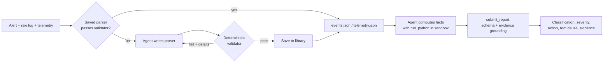

# FaultLine

**A coding agent that learns to read GPU logs it has never seen, proves its own parsers, and triages sick GPU nodes from the evidence.**

Built for the Nebius x NVIDIA Global AI Hackathon, *Coding & Agentic Engineering* track. The reasoning engine is an NVIDIA Nemotron model (`nvidia/nemotron-3-super-120b-a12b`) served by Nebius Token Factory through its OpenAI-compatible API, using native tool calling.


## The problem

When a GPU node in a large cluster misbehaves, someone has to read its kernel log and telemetry and decide what to do: reset the GPU, drain and reboot the node, RMA the card, or tell the job owner their code is at fault. A wrong call is expensive either way.

Two things make this hard to automate:

1. **The data is messy and varies.** The same NVIDIA Xid line arrives as raw `dmesg`, syslog, journald text, journald JSON or a container log. DCGM telemetry arrives as CSV, JSONL, dmon tables or Prometheus text. Driver versions add and change fields. Every new source normally means someone writes and maintains a new parser.
2. **Asking a model to eyeball a long log gives confident, unverifiable answers.** Models miscount events and miss lines.

## What FaultLine does

It turns parsing into a verified, cached capability and makes the model reason only from computed facts.

1. **Library first.** Each raw file gets a cheap format fingerprint. The agent tries saved parsers (exact fingerprint first) and **re-validates each against the raw file**. A pass means zero LLM tokens spent on parsing.
2. **Learn when unfamiliar.** Otherwise the agent writes a parser with the `write_parser` tool. It runs in a sandbox and a deterministic validator checks it against the raw text. Failures come back with exact details so the agent can fix them. Passing parsers are saved to the library.
3. **Triage from evidence.** With `events.json` and `telemetry.json` available, the agent uses `run_python` to compute counter deltas, per-Xid counts, max temperature and clock drops, looks up Xid codes, then calls `submit_report`.



### Guardrails

- **Validators check parsers against the raw file, not against the model.** Every `NVRM: Xid` line must be captured with the right code and pid; AER and throttle line counts must match; telemetry row counts must match; no invented numbers; cumulative counters must not decrease.
- **Evidence grounding.** A report is rejected if the numbers in its evidence do not appear in the agent's own code output.
- **Mandatory telemetry review.** The agent cannot submit until it has run analysis, because many faults leave no Xid at all.
- **Schema-validated reports** with a fixed set of classifications and actions.
- **Graceful degradation.** If a parser cannot be learned in 5 attempts, the agent falls back to analysing the raw files.
- **Sandboxed execution.** Model-written code runs in a subprocess with CPU, file-size and time limits (plus memory and process limits on Linux).

Classifications: `application`, `memory`, `pcie`, `interconnect`, `thermal`, `none`. Actions: `monitor`, `gpu_reset`, `drain_reboot`, `rma`, `investigate_workload`, `inspect_cooling`.

## Results

Measured on synthetic incidents (7 scenarios x 3 log/telemetry formats x 2 seeds, empty parser library at the start). Prompts were tuned against this set, so read these as pipeline results, not field accuracy.

| Metric | Result |
|---|---|
| Correct classification / action | 42 / 42 and 42 / 42 |
| Triage that had to **learn** parsers (unseen formats) | avg 36 s, 6.3 tool calls, about 41k tokens |
| Triage that **reused** saved parsers | avg 9 s, 3.0 tool calls, about 9.6k tokens |
| Saved parsers reused without rewriting | 38 / 39 |
| Same incident run twice: identical parsed evidence / decision | 4 / 4 and 4 / 4 |

**Real public lines.** `real_samples.py` wraps three verbatim Xid lines from public pages ([Netdata](https://www.netdata.cloud/guides/nvidia-gpu/nvidia-gpu-xid-errors/) and [Crusoe support](https://support.crusoecloud.com/hc/en-us/articles/28336238021915-XID-Errors-Observed-in-Dmesg)) in raw `dmesg` framing with seconds-since-boot timestamps, including quirks like `pid='<unknown>'`. The agent learned a parser, reused it, and produced sensible actions. These lines have no ground-truth labels, so this checks format robustness only, not accuracy.


## Quickstart

Requires Python 3.9+ and a Nebius Token Factory API key.

```bash
git clone <this-repo> && cd faultline
python3 -m venv .venv && source .venv/bin/activate
pip install openai fastapi uvicorn pydantic

cp .env.example .env            # then put your key in .env
set -a; . ./.env; set +a

python3 -m uvicorn server:app --port 8000
```

Open <http://localhost:8000>, pick a log format and a scenario, and watch the agent. Run a second scenario in the same format to see parser reuse. The reset button clears the library.

Other entry points:

```bash
python3 cli.py fell_off_bus 1   # one triage in the terminal (scenario, format 0-2)
python3 eval.py 2               # cold-start eval: learn -> reuse -> determinism (several minutes)
python3 real_samples.py         # the real public Xid lines
```

Configuration (environment variables): `NEBIUS_API_KEY` (required), `FAULTLINE_MODEL` (default `nvidia/nemotron-3-super-120b-a12b`), `NEBIUS_BASE_URL` (default `https://api.tokenfactory.nebius.com/v1/`), `FAULTLINE_LIB` (parser library directory, default `library`).

## Project layout

| File | Purpose |
|---|---|
| `agent.py` | Tool-calling loop: library lookup, `write_parser`, `run_python`, `lookup_xid`, `submit_report` |
| `parserlib.py` | Parser library, format fingerprints, sandboxed parser execution |
| `validators.py` | Deterministic oracles that check parsers against the raw file |
| `sandbox.py` | Subprocess sandbox with resource limits |
| `schemas.py` | Report schema and Xid reference table |
| `loggen.py` | Synthetic incident generator: 3 log formats, 3 telemetry formats, 7 scenarios |
| `server.py`, `static/index.html` | FastAPI backend streaming agent steps over SSE, and the web UI |
| `eval.py`, `real_samples.py`, `cli.py` | Evaluation and command-line tools |

Scenarios: uncorrectable ECC with row-remap exhaustion, GPU fell off the bus, flaky NVLink, harmless application Xid 13, healthy node, correctable ECC creeping up with no Xid, thermal throttling with no Xid.

## Limitations

- Incidents are synthetic apart from the three real public lines. Accuracy on real fleet data is untested.
- Validators know about GPU Xid, AER and throttle events and DCGM-style telemetry. Supporting other hardware logs means adding a task spec (what to extract plus a pattern for the lines that must be captured).
- Learning a parser is not fully reliable. Runs occasionally need several attempts, and the agent falls back to raw-file analysis after 5.
- The agent only recommends an action. It does not drain, reset or ticket anything, and there is no human approval flow yet.
- The sandbox is a resource-limited subprocess, not a container. On macOS the memory and process limits are skipped.
- Nemotron's weights are not trained or fine-tuned here. The "learning" is a library of validated parsers kept outside the model.

## What's next

Real log sources (journald, DCGM exporter, Slurm events), fleet-level correlation across nodes, an approval step with drain and ticketing connectors, container-grade isolation such as Nebius serverless jobs, and an evaluation set of labelled real incidents.

## Security

Never commit `.env`. It is git-ignored. If a key is ever exposed, rotate it in the Nebius console.
