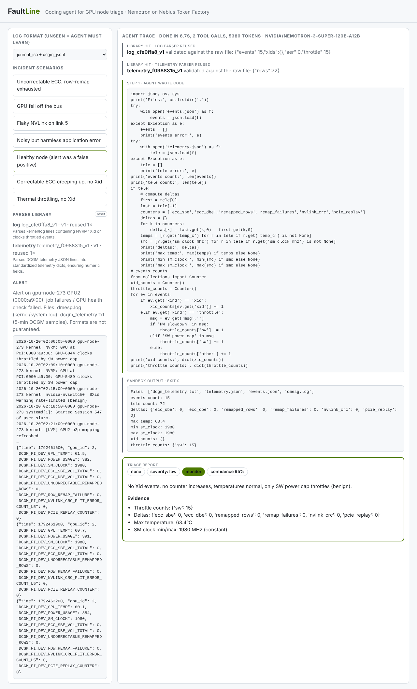
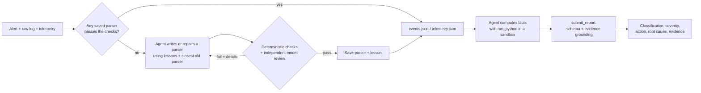
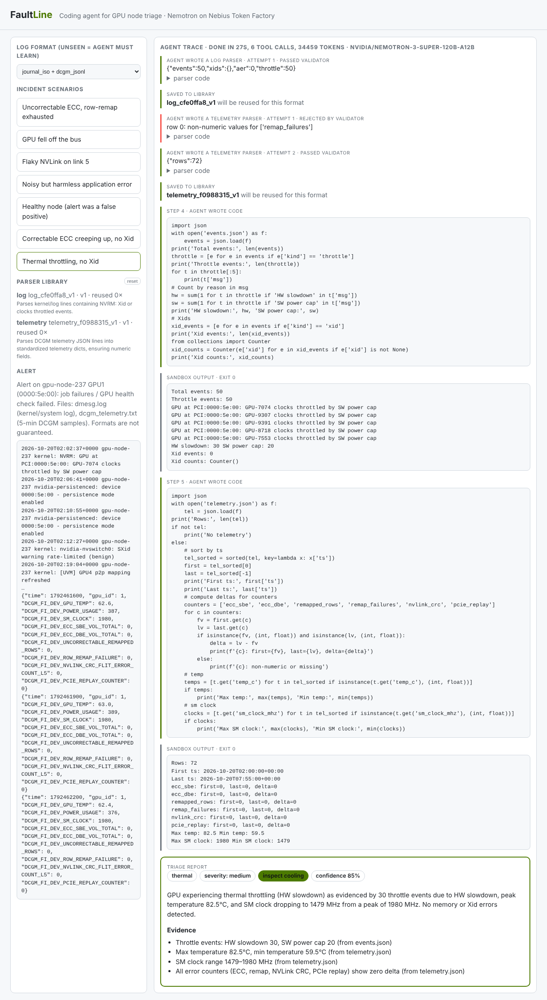

# FaultLine

**A coding agent that learns to read GPU logs it has never seen, repairs its own parsers when a format changes, and triages sick GPU nodes from the evidence.**

Built for the Nebius x NVIDIA Global AI Hackathon, *Coding & Agentic Engineering* track. The reasoning engine is an NVIDIA Nemotron model (`nvidia/nemotron-3-super-120b-a12b`) served by Nebius Token Factory through its OpenAI-compatible API, using native tool calling.



## The problem

When a GPU node in a large cluster misbehaves, someone has to read its kernel log and telemetry and decide what to do: reset the GPU, drain and reboot the node, RMA the card, or tell the job owner their code is at fault. A wrong call is expensive either way.

Two things make this hard to automate:

1. **The data is messy and keeps changing.** The same NVIDIA Xid line arrives as raw `dmesg`, syslog, journald text, journald JSON or a container log. DCGM telemetry arrives as CSV, JSONL, dmon tables or Prometheus text. Driver versions change the wording. Every new or changed source normally means someone writes and maintains a parser.
2. **Asking a model to eyeball a long log gives confident, unverifiable answers.** Models miscount events and miss lines.

## What FaultLine does

It makes parsing a verified, self-repairing capability and makes the model reason only from computed facts.

1. **Library first.** Each raw file is tried against saved parsers (a cheap format fingerprint only decides the order). Every candidate is **re-validated against the raw file**. A pass means zero LLM tokens spent on parsing.
2. **Learn when unfamiliar.** Otherwise the agent writes a parser with the `write_parser` tool. It runs in a sandbox, is checked by deterministic validators, and then **reviewed by an independent model call** that compares its output with sample raw lines. Passing parsers are saved.
3. **Repair when a format drifts.** If saved parsers stop validating, the agent is handed the closest old parser plus the exact failures and adapts it, keeping it working for the old format too.
4. **Learn from mistakes.** After recovering from failed attempts, the agent writes a short general lesson that is included in future runs.
5. **Triage from evidence.** With `events.json` and `telemetry.json` available, the agent uses `run_python` to compute counter deltas, per-Xid counts, temperatures and clock drops, looks up Xid codes, then calls `submit_report`.



### Guardrails

- **Format-tolerant validators check parsers against the raw file, not against the model.** Every raw line containing the word `Xid` (nvswitch `SXid` excluded) must become an event whose code and pid appear as standalone numbers in that line, with no assumption about where they sit. AER and throttle line counts must match. Telemetry row counts must match, no value may be invented, counters must not decrease, and **any raw column that changes over time must be carried by some parsed field**. That last check caught a parser that had silently defaulted a misnamed field to 0.
- **Independent model review.** A fresh model call inspects each new parser's output against sample raw lines for wrong codes, mixed-up columns and bad timestamps.
- **Evidence grounding.** A report is rejected if the numbers in its evidence do not appear in the agent's own code output.
- **Mandatory telemetry review.** The agent cannot submit until it has run analysis, because many faults leave no Xid at all.
- **Schema-validated reports** with a fixed set of classifications and actions.
- **Graceful degradation.** If a parser cannot be learned in 5 attempts, the agent falls back to analysing the raw files.
- **Sandboxed execution.** Model-written code runs in a subprocess with CPU, file-size and time limits (plus memory and process limits on Linux).

Classifications: `application`, `memory`, `pcie`, `interconnect`, `thermal`, `none`. Actions: `monitor`, `gpu_reset`, `drain_reboot`, `rma`, `investigate_workload`, `inspect_cooling`.

## Results

Measured on synthetic incidents with an empty parser library at the start. Prompts were tuned on this set, and one run of the pipeline is a small sample, so read these as pipeline results, not field accuracy.

| Test | Result |
|---|---|
| Triage across 7 scenarios x 3 log/telemetry formats x 2 seeds (42 runs) | 40 / 42 correct classification and action in the latest run (42 / 42 in the run before). Misses differ from run to run and re-run correctly, so they are model variance, not parsing errors |
| Learning parsers for unseen formats | avg 45 s, 6.0 tool calls, about 44k tokens |
| Reusing saved parsers | avg 9 s, 3.2 tool calls, about 10.8k tokens; reused without rewriting in 39 / 39 runs |
| Same incident run twice | identical parsed evidence 4 / 4, identical decision 4 / 4 |
| **Format drift** (hypothetical future Xid wordings the agent has never seen) | first sighting: 4 / 4 correct, 4 / 4 parsers repaired (avg 33 s). Later runs on the new formats: 12 / 12 correct with no further rewrites. Old format afterwards: 6 / 6 correct, no rewrites |

**Real public lines.** `real_samples.py` wraps three verbatim Xid lines from public pages ([Netdata](https://www.netdata.cloud/guides/nvidia-gpu/nvidia-gpu-xid-errors/) and [Crusoe support](https://support.crusoecloud.com/hc/en-us/articles/28336238021915-XID-Errors-Observed-in-Dmesg)) in raw `dmesg` framing with seconds-since-boot timestamps, including quirks like `pid='<unknown>'`. The agent learned a parser (3 attempts), reused it for the other two lines, and produced sensible actions. These lines have no ground-truth labels, so this checks format robustness only, not accuracy.



## Quickstart

Requires Python 3.9+ and a Nebius Token Factory API key.

```bash
git clone <this-repo> && cd faultline
python3 -m venv .venv && source .venv/bin/activate
pip install openai fastapi uvicorn pydantic

cp .env.example .env            # then put your key in .env
set -a; . ./.env; set +a

python3 -m uvicorn server:app --port 8000
```

Open <http://localhost:8000>, pick a log format and a scenario, and watch the agent. Run a second scenario in the same format to see parser reuse. The reset button clears the library.

Other entry points:

```bash
python3 cli.py fell_off_bus 1   # one triage in the terminal (scenario, format 0-2)
python3 eval.py 2               # full eval: learn -> reuse -> determinism -> format drift (about 10 minutes)
python3 real_samples.py         # the real public Xid lines
```

Configuration (environment variables): `NEBIUS_API_KEY` (required), `FAULTLINE_MODEL` (default `nvidia/nemotron-3-super-120b-a12b`), `NEBIUS_BASE_URL` (default `https://api.tokenfactory.nebius.com/v1/`), `FAULTLINE_LIB` (parser library directory, default `library`).

## Project layout

| File | Purpose |
|---|---|
| `agent.py` | Tool-calling loop: library lookup, repair, `write_parser`, `run_python`, `lookup_xid`, `submit_report` |
| `parserlib.py` | Parser library (many parsers per format), lessons memory, fingerprints, sandboxed parser execution |
| `validators.py` | Deterministic, format-tolerant checks of parsers against the raw file |
| `review.py` | Independent model review of new parsers and lesson writing |
| `sandbox.py` | Subprocess sandbox with resource limits |
| `schemas.py` | Report schema and Xid reference table |
| `loggen.py` | Synthetic incidents: 3 log formats, 3 telemetry formats, 7 scenarios, plus hypothetical future Xid wordings for drift tests |
| `server.py`, `static/index.html` | FastAPI backend streaming agent steps over SSE, and the web UI |
| `eval.py`, `real_samples.py`, `cli.py` | Evaluation and command-line tools |

Scenarios: uncorrectable ECC with row-remap exhaustion, GPU fell off the bus, flaky NVLink, harmless application Xid 13, healthy node, correctable ECC creeping up with no Xid, thermal throttling with no Xid.

## Limitations

- Incidents are synthetic apart from the three real public lines, and the drift formats are hypothetical, not real NVIDIA changes. Accuracy on real fleet data is untested.
- The validators still anchor on the word "Xid" and on GPU Xid, AER and throttle events plus DCGM-style telemetry. Supporting other hardware logs means adding a task spec (what to extract plus a pattern for the lines that must be captured).
- The model reviewer and the lessons are themselves model output and can be wrong. The deterministic checks are the backstop, and lessons are not verified before reuse.
- Learning or repairing a parser is not fully reliable. Some runs need several attempts, and the agent falls back to raw-file analysis after 5.
- Final decisions vary slightly between runs even at temperature 0.
- The agent only recommends an action. It does not drain, reset or ticket anything, and there is no human approval flow yet.
- The sandbox is a resource-limited subprocess, not a container. On macOS the memory and process limits are skipped.
- Nemotron's weights are not trained or fine-tuned here. The "learning" is a library of validated parsers and a lessons file kept outside the model.

## What's next

Real log sources (journald, DCGM exporter, Slurm events), fleet-level correlation across nodes, an approval step with drain and ticketing connectors, container-grade isolation such as Nebius serverless jobs, and an evaluation set of labelled real incidents.

## Security

Never commit `.env`. It is git-ignored. If a key is ever exposed, rotate it in the Nebius console.
